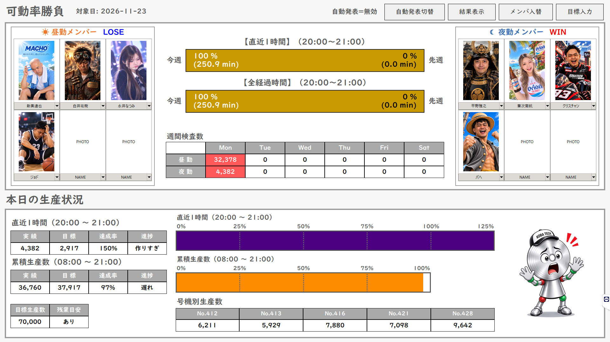

# Step3 可動率勝負アプリ 操作説明書
最終更新: 2026-11-24

## 1. 起動方法

デスクトップ上の `ボディ見える化` ショートカットをダブルクリックします。以下の2つのアプリが起動されます。
| アプリ名 | 機能 |
| --- | --- |
| Dashboard | メインプログラム。可動率表示と当日生産数を表示する。 |
| PLC Data Collector | 定期的にPLCからデータを収集し、DBに登録するプログラム。 |

> **＜注意＞**  
> 起動する前に上記プログラムが実行されていないことを確認してください（二重起動の防止）。

## 2. メイン画面


### 全画面表示の解除
`ESC`キーまたは`F11`キーを押すことで、全画面表示を解除できます（ウィンドウのタイトルバーが表示され、モニター下部にタスクバーが表示されます）。再度`F11`キーを押すと全画面表示されます。

## 3. 各ボタンの機能

| ボタン | 機能・操作方法 |
|---|---|
| **自動発表切替** | 自動発表の有効・無効を切り替えます。有効にすると毎時05分に直前1時間の結果を自動発表します。 |
| **結果表示** | 任意の日時の結果を手動表示します。ボタンを押し、基準日時を `YYYY-MM-DD HH:00` 形式で入力してください。例：`2026-11-23 18:00` は18:00～19:00の結果です。 |
| **メンバ入替** | 昼勤と夜勤のメンバーを、画面上の同じ位置同士で一括入れ替えます。 |
| **目標入力** | 指定した生産日の目標生産数を登録・更新します。入力形式は `YYYY-MM-DD/目標生産数` です。例：`2026-11-23/70000` |

### メンバーを個別に変更する場合

各メンバーの写真の下にある選択欄から、表示する名前を選んでください。変更したメンバー情報は、アプリ終了時に保存されます。

## 4. 結果画面の見方

- **直近1時間・全経過時間**：今週と先週の稼働時間を割合と分数で比較します。結果発表後、メンバーの表情と勝敗（WIN / LOSE / DRAW）が表示されます。
- **週間検査数**：月曜日から土曜日までの検査数を昼勤・夜勤別に表示します。
- **本日の生産状況**：直近1時間・累積の実績、目標、達成率、進捗、号機別生産数などを表示します。

## 5. 終了

- 全画面表示を解除し（`ESC`または`F11`）、メインウィンドウ右上の`X`マークをクリックします。
- タイトルが`Dashboard`と`PLC Data Collector`の黒いウィンドウ（コンソール）を閉じます。

## 6. 注意事項

- 生産日は **午前8:00** に切り替わります。午前0:00～7:59は前日の生産日として扱います。
- 自動発表はアプリ起動時には無効です。必要に応じて「自動発表切替」を押してください。


## 7. スタッフの追加・削除
スタッフの追加または削除をする場合は、アプリケーションフォルダ内の `staff_shift_info.json` ファイルを編集します。
このファイルの `staff` キーへ追加または削除します。
なお、`"日本語表記": "英語表記"` の形式で追加します。`"日本語表記"` は画面中のドロップダウンリストへ表示されます。`"英語表記"` は顔写真の画像ファイル名に使われます。

## 8. スタッフ顔写真の保存場所
画面に表示されるスタッフの顔写真(PNG形式画像)はアプリケーションフォルダ内の `staff_photo` フォルダ内に保存します。ファイル名は `staff_shift_info.json` ファイルで定義した `"英語表記"` が使われます。各表情に対して以下のファイル名となります。
```TEXT
笑顔の写真:       (英語表記)_smile.png
普通の写真:       (英語表記)_normal.png
悲しんでいる写真:  (英語表記)_sad.png
```

---


